<!--
  view-source. hi.

  everything below is compiled by render.py: every letter shaped by HarfBuzz
  and outlined to a vector path at build time. no badges, no widgets,
  no web fonts, no javascript.

  'z' ^ 0x12 == 'h'
-->

<picture>
  <source media="(prefers-color-scheme: dark)" srcset="https://raw.githubusercontent.com/zerotohero3/zerotohero3/main/assets/hero.dark.svg">
  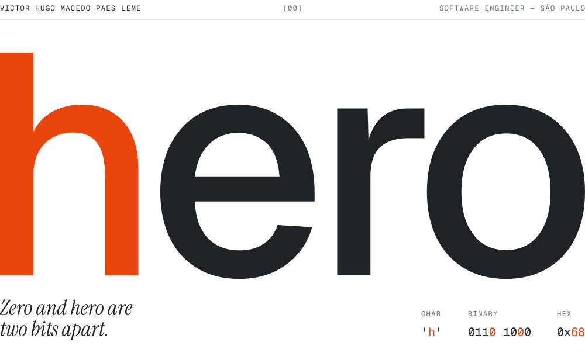
</picture>

  

<picture>
  <source media="(prefers-color-scheme: dark)" srcset="https://raw.githubusercontent.com/zerotohero3/zerotohero3/main/assets/principle.dark.svg">
  
</picture>

  

<picture>
  <source media="(prefers-color-scheme: dark)" srcset="https://raw.githubusercontent.com/zerotohero3/zerotohero3/main/assets/index.dark.svg">
  
</picture>

  

<!-- oss: generated by render.py -->
<picture>
  <source media="(prefers-color-scheme: dark)" srcset="https://raw.githubusercontent.com/zerotohero3/zerotohero3/main/assets/oss.dark.svg">
  
</picture>
<a href="https://github.com/tailwindlabs/tailwindcss/pull/20658"><picture>
  <source media="(prefers-color-scheme: dark)" srcset="https://raw.githubusercontent.com/zerotohero3/zerotohero3/main/assets/oss-tailwindlabs-tailwindcss.dark.svg">
  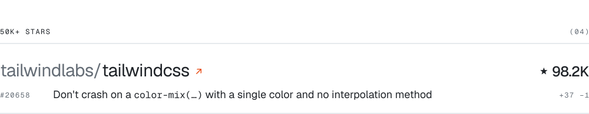
</picture></a>
<a href="https://github.com/webpack/webpack/pull/23090"><picture>
  <source media="(prefers-color-scheme: dark)" srcset="https://raw.githubusercontent.com/zerotohero3/zerotohero3/main/assets/oss-webpack-webpack.dark.svg">
  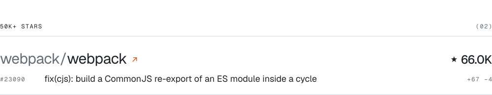
</picture></a>
<a href="https://github.com/ChromeDevTools/chrome-devtools-mcp/pulls?q=is%3Apr+is%3Amerged+author%3Azerotohero3"><picture>
  <source media="(prefers-color-scheme: dark)" srcset="https://raw.githubusercontent.com/zerotohero3/zerotohero3/main/assets/oss-chromedevtools-chrome-devtools-mcp.dark.svg">
  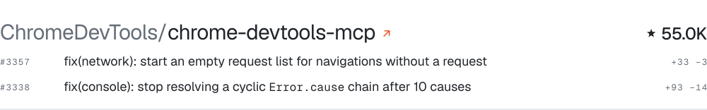
</picture></a>
<a href="https://github.com/mozilla/pdf.js/pull/22417"><picture>
  <source media="(prefers-color-scheme: dark)" srcset="https://raw.githubusercontent.com/zerotohero3/zerotohero3/main/assets/oss-mozilla-pdf.js.dark.svg">
  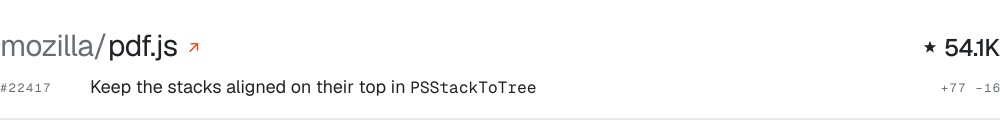
</picture></a>
<a href="https://github.com/curl/curl/pulls?q=is%3Apr+is%3Aclosed+author%3Azerotohero3"><picture>
  <source media="(prefers-color-scheme: dark)" srcset="https://raw.githubusercontent.com/zerotohero3/zerotohero3/main/assets/oss-curl-curl.dark.svg">
  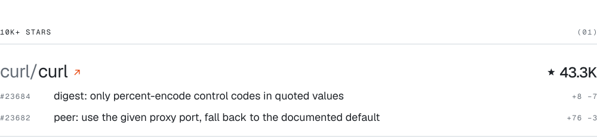
</picture></a>
<a href="https://github.com/modelcontextprotocol/csharp-sdk/pull/1917"><picture>
  <source media="(prefers-color-scheme: dark)" srcset="https://raw.githubusercontent.com/zerotohero3/zerotohero3/main/assets/oss-modelcontextprotocol-csharp-sdk.dark.svg">
  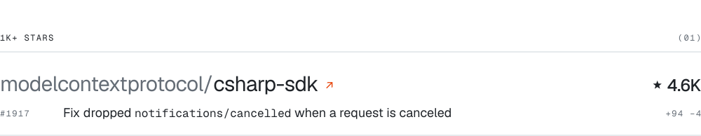
</picture></a>
<!-- /oss -->

  

<picture>
  <source media="(prefers-color-scheme: dark)" srcset="https://raw.githubusercontent.com/zerotohero3/zerotohero3/main/assets/colophon.dark.svg">
  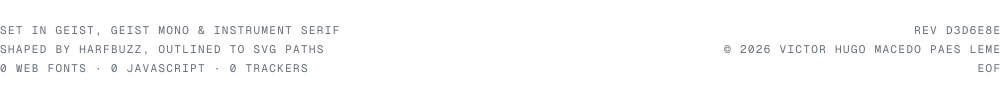
</picture>
